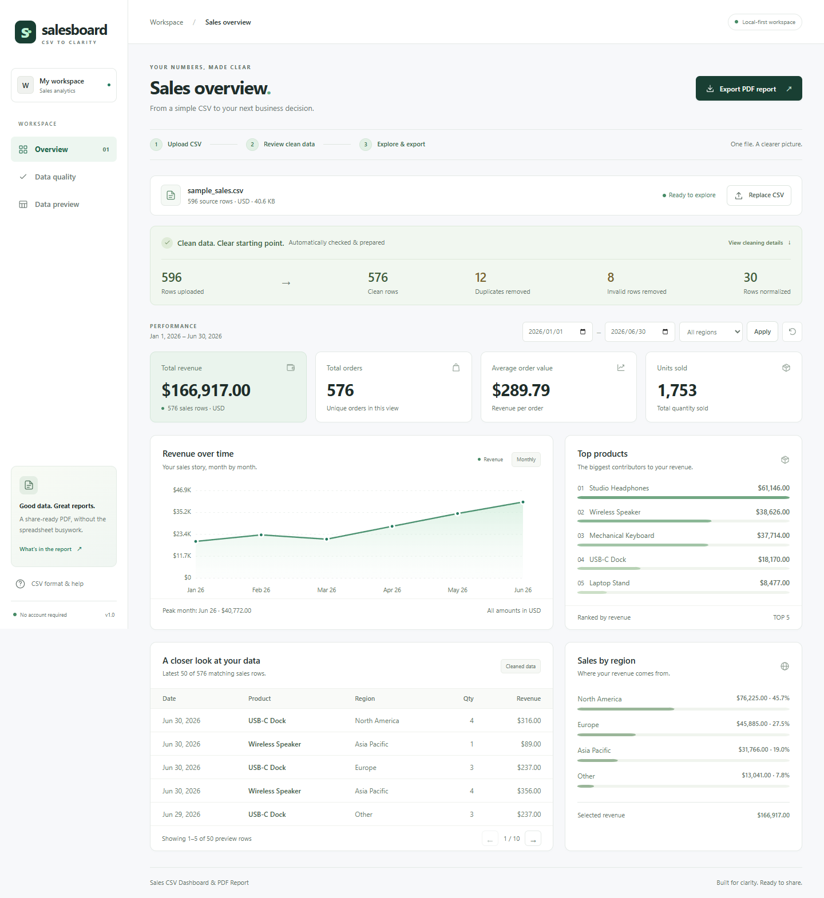
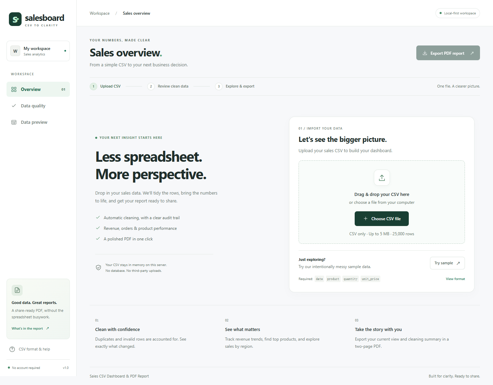

# Sales CSV Dashboard & PDF Report

**Upload a CSV. Understand the clean data. Explore your sales. Download a PDF in one click.**

Salesboard is a small, complete Python full-stack application for turning sales exports into a polished analytical dashboard and a two-page report. It runs locally, requires no account or API key, and has no frontend build step.



## Quick start

Requires **Python 3.11+**. From this repository's root:

```bash
python -m venv .venv
```

Activate the environment:

```powershell
# Windows PowerShell
.\.venv\Scripts\Activate.ps1
```

```bash
# macOS / Linux
source .venv/bin/activate
```

Install and run:

```bash
python -m pip install -r requirements.txt
python -m sales_dashboard
```

Open **http://127.0.0.1:8000**. Click **Try sample** to exercise the entire workflow without preparing a file. You can also upload [`sample_sales.csv`](sales_dashboard/data/sample_sales.csv) using **Choose CSV file** or drag and drop.

If PowerShell blocks activation, activation is optional:

```powershell
.\.venv\Scripts\python.exe -m pip install -r requirements.txt
.\.venv\Scripts\python.exe -m sales_dashboard
```

Alternatively, `python -m pip install .` installs the `sales-dashboard` command. The wheel includes templates, static assets and the sample CSV.

## The workflow

1. **Upload:** choose or drop one UTF-8 CSV (under 5 MB, up to 25,000 non-empty sales rows).
2. **Review cleaning:** inspect rows read, retained, removed and normalized. Expand the audit details for reasons and the first 20 excluded CSV line numbers.
3. **Explore:** view revenue, orders, average order value, units sold, monthly revenue, top five products, regional sales and a paginated preview. Apply date and region filters.
4. **Export:** click **Export PDF report** once. The app generates and downloads a PDF with the *applied* filters and the same calculations as the dashboard. No print dialog or second confirmation.



Both screenshots above were captured from the running app, using the bundled fictional dataset. View the actual [sample PDF](docs/sample-report.pdf).

## CSV format

```csv
order_id,date,product,quantity,unit_price,region,category,currency
SO-001,2026-01-05,Studio Headphones,2,129.00,North America,Audio,USD
SO-001,2026-01-05,Desk Mat,1,29.00,North America,Workspace,USD
SO-002,2026-01-06,USB-C Dock,1,79.00,Europe,Accessories,USD
```

| Column | Required | Rules |
| --- | --- | --- |
| `date` | Yes | `YYYY-MM-DD`, `YYYY/MM/DD`, or **US** `MM/DD/YYYY`; years 1900–2100 |
| `product` | Yes | Non-empty name; case-sensitive |
| `quantity` | Yes | Positive whole number, at most 1,000,000 |
| `unit_price` | Yes | Non-negative decimal; at most two meaningful decimal places; maximum 1,000,000,000 |
| `order_id` | No | Distinct IDs count as orders; rows missing an ID each count as one order |
| `region` | No | Missing values become `Unknown` |
| `category` | No | Missing values become `Uncategorized` |
| `currency` | No | `USD` (default), `EUR`, `GBP`, `CAD`, `AUD`; one currency per file |

- Comma or semicolon delimiters, quoted values, UTF-8 BOM and CRLF are supported. Delimiter selection uses the header line.
- Headers are trimmed and lowercased; spaces and hyphens become underscores. Common aliases include `order_date`, `sale_date`, `sales_date`, `product_name`, `item`, `qty`, `price`, `unitprice`, `order`, `order_number` and `sales_region`.
- Currency symbols, decimal commas, scientific notation, negative values and non-finite numbers are rejected. Properly grouped thousands such as `"1,299.00"` are supported.
- Unknown columns are listed and ignored. Extra columns never override calculated revenue. At most 50 columns and 256 characters per field are supported.
- Use a unique order ID for distinct transactions. Identical sales without unique IDs can be removed as duplicates. Multi-line orders may reuse an ID; different product lines remain separate.

## Cleaning and metric definitions

Blank lines are skipped. Each other row is processed in this order:

1. Reject a wrong field count or a field longer than 256 characters.
2. Trim values; reject missing required values.
3. Standardize dates; reject invalid dates.
4. Validate quantities and prices; reject invalid numbers.
5. Validate a single supported currency. A mixed/unsupported currency makes the whole upload fail.
6. Fill optional labels and remove exact duplicate normalized rows across all recognized fields.

Every removed row has **one primary reason**. Normalized-row counts refer to retained rows whose whitespace, date, grouped-number or currency casing changed. Normalization does not remove rows. Optional-field defaults are counted separately.

| Metric | Calculation |
| --- | --- |
| Revenue | Sum of `quantity × unit_price`, using Python `Decimal` |
| Orders | Distinct non-empty `order_id` values, plus one for each row missing an ID |
| Average order value | Selected revenue ÷ selected orders, rounded half up to two decimals |
| Units sold | Sum of selected quantities |
| Monthly revenue | Revenue grouped by calendar month, including zero-sales months between the first and last selected sale |
| Top products | Up to five products ranked by selected revenue; alphabetical tie-break |

Filters are inclusive and apply to line items, including partial orders. A filtered order value therefore refers to the included lines of those orders. Cleaning counts always describe the entire source file. The preview contains the latest **50** matching rows, in pages of five; all retained matching rows contribute to metrics and PDF values.

The bundled sample contains **596 source rows**, **576 retained rows**, **12 duplicates**, **8 invalid rows** and **30 normalized rows**. It produces **$166,917.00 revenue**, **576 orders**, **$289.79 average order value** and **1,753 units**. Sample generation is deterministic: `python scripts/generate_sample.py`.

## PDF report

- Page 1: period, region and currency; four metrics; vector revenue chart; top products.
- Page 2: source filename, generation time in UTC, applied filters, source-wide cleaning totals and methodology.
- ReportLab generates the report server-side; no browser printing or external PDF service is needed.
- Bitstream Vera fonts are embedded from the ReportLab distribution. Latin labels render portably; glyphs outside the embedded font are replaced with `?`. The web dashboard displays Unicode labels normally.
- Long labels are shortened with an ellipsis in the PDF. Full labels remain in the CSV and dashboard title tooltips.

## Privacy and scope

The server processes each upload in memory and does not write sales files, analysis results or reports to a database or disk. The browser holds the chosen file in memory and resubmits it for filtering and export; reloading the page clears the workspace. Ordinary access logs contain request metadata, not CSV contents. No analytics, remote fonts, CDN assets or third-party data services are used. After dependencies are installed, the app works without internet access.

This is a single-workspace local reporting tool, not an accounting system. It does not model refunds, taxes, discounts, currency conversion, inventory or authentication. Total source revenue is capped at 1 trillion to keep browser currency rendering within a sensible precision range. The PDF and dashboard share the same server-side aggregation, but UI numbers are serialized as standard JSON numbers.

The default listener is `127.0.0.1`. If exposing it publicly, use your own TLS reverse proxy, authentication and request limits; uploaded data is then processed on **your server**, not exclusively in the visitor's browser. The app does not include a multi-tenant hosting platform.

## Configuration and Docker

| Environment variable | Default | Purpose |
| --- | --- | --- |
| `HOST` | `127.0.0.1` | Bind interface |
| `PORT` | `8000` | HTTP port |

The runtime uses Waitress on Windows, macOS and Linux. Flask debug mode is off. `/health` returns `{"status":"ok"}`.

```bash
docker build -t sales-csv-dashboard-pdf .
docker run --rm -p 127.0.0.1:8000:8000 sales-csv-dashboard-pdf
```

The container runs as a non-root user. Docker sets `HOST=0.0.0.0` internally; the example publishes the port to your machine's loopback interface only.

## Development and tests

```bash
python -m pip install -e ".[dev]"
python -m pytest -q
python -m ruff check .
python -m pip wheel . --no-deps --wheel-dir dist
```

Tests cover cleaning reconciliation, decimal math, order counting, duplicates, malformed input, UTF-8/BOM, delimiters, mixed currencies, filter boundaries, empty selections, limits, route headers and two-page PDF contents. GitHub Actions runs them on Windows and Linux with Python 3.11–3.13. The workflow is supplied; a remote CI run will occur after you push.

An optional real-browser smoke test is provided. **Node.js is only needed for this developer test**, never for running the app:

```bash
npm install --no-save playwright@1.62.1
npx playwright install chromium
# Start the Python app in another terminal first.
node scripts/browser-smoke.cjs
```

Set `BROWSER_EXECUTABLE` to an installed Chrome/Chromium executable to skip the browser download. Set `BASE_URL` if using another port. Test screenshots and downloads go to the ignored `test-results/` directory. See [the validation record](docs/VALIDATION.md) for checks performed for this release.

## Repository layout

```text
sales_dashboard/
  __init__.py             Flask factory, upload and report routes
  __main__.py             Cross-platform Waitress entry point
  analysis.py             CSV cleaning and shared calculations
  report.py               Two-page vector PDF
  templates/index.html    Accessible application structure
  static/                 CSS, JavaScript and SVG favicon
  data/sample_sales.csv    Reproducible fictional sales dataset
tests/test_app.py         Unit and HTTP integration tests
scripts/                 Sample generator and browser smoke test
docs/                    Real screenshots, sample PDF, validation notes
.github/workflows/ci.yml  Windows/Linux test matrix
```

## Contributing and license

See [CONTRIBUTING.md](CONTRIBUTING.md) for development conventions. The application code is available under the [MIT License](LICENSE). See [THIRD_PARTY_NOTICES.md](THIRD_PARTY_NOTICES.md) for bundled dependencies and font notices. All sample data is fictional; the interface and SVG icons were created for this project.
